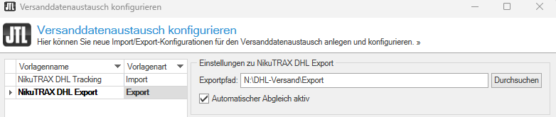
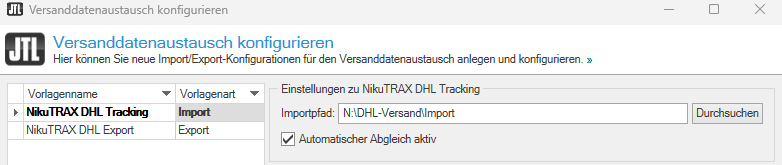

# CSV-Installation und Migration (v1.15-beta.1)

## 1. Voraussetzungen und sichere Migration

Windows PowerShell 5.1, DHL-API-Zugang, JTL-Wawi mit Versanddatenexport/-import. Pilot erfolgreich unter JTL-Wawi 2.1.2 in einer Installation getestet; ob die automatische Verarbeitung Packtisch+ oder WMS voraussetzt, ist pro Installation zu prüfen.

Alten SQL-Worker und alle anderen Labelerzeuger stoppen (auch Aufgabenplanung). Konfiguration, Skripte, Export-/Importordner, Statusdateien, Labels und Sicherungen sichern. Keine echten Zugangsdaten, Kundenadressen oder Versanddateien in GitHub ablegen. Bereits gebuchte oder ungeklärte Pakete im DHL-Portal und JTL abgleichen; alte Exportdateien außerhalb des überwachten Ordners sichern. Statusordner nicht leeren, dieselben Paket-IDs dürfen nicht erneut gebucht werden. Bei mehreren JTL-Mandanten separate Verzeichnisse und Statusordner benutzen.

## 2. JTL-Vorlagen

Versanddatenexport: Semikolon, eine Kopfzeile, genau ein Paket je CSV. PaketRef ist die interne Paketnummer mit Präfix P, z. B. `P{{Paket.InternePaketnummer}}`. Spalten gemäß `JTL-Export-Kopfzeile.txt`:

```csv
PaketRef;Lieferschein;Versandart;Vorname;Nachname;Firma;Adresszusatz;Strasse;Hausnummer;PLZ;Ort;LandISO;Email;Telefon;Mobil;Gewicht
```

Beim Ausliefern Versanddaten exportieren, das Versanddatum nicht vorab setzen. Nur offene, noch nicht gebuchte Pakete exportieren. Versanddatenimport: Semikolon, eine Kopfzeile, Spalte 1 ID-Nummer, Spalte 2 Tracking-Nr. Importordner aus der Konfiguration verwenden. Beispiel (nur fiktive Daten):

```csv
PaketRef;Tracking
P1234;TEST123456789
```

Automatischen Abgleich aktivieren und mit einem getrennten internen Testlieferschein prüfen (keine Kundenbenachrichtigung, kein echter Labelkauf). Vor dem Test alle Labelerzeuger stoppen. Test-Exportdatei anschließend aus dem Exportordner archivieren. In JTL sowohl Trackingnummer als auch Versanddatum kontrollieren. Bei ausbleibendem Import JTL-Konfiguration und gegebenenfalls Packtisch+/WMS prüfen.

### Exportvorlage in JTL-Wawi anlegen

Öffne **Vorlagen für Versanddatenexport anlegen und bearbeiten**. Über **Anlegen** eine eigene Vorlage erstellen oder eine vorhandene eigene Vorlage mit **Bearbeiten** öffnen. Im Beispiel heißt sie **NikuTRAX DHL Export**.

In der getesteten Konfiguration ist bei **Aktion bei vorhandener Datei** die Option **Vorhandene Datei überschreiben** eingestellt. Diese Einstellung ersetzt nicht den Buchungsschutz des Workers. Dateinamen müssen eindeutig genug sein, damit offene Exportdateien nicht durch andere Pakete überschrieben werden. Mehrpaketsendungen sind nicht für die Automatik freigegeben.

Öffne die Vorlage mit **Bearbeiten**. Unter **Ausgabe** den individuellen Dateipfad einstellen. Der Dateiname der Pilotinstallation verwendet die Lieferschein-Belegnummer und einen Zeitstempel (yyyyMMdd_HHmmss). Der vollständige Ausdruck ist im Screenshot rechts abgeschnitten; er wird daher hier nicht als exakte Kopiervorlage angegeben.

#### Kopfzeile

Im Reiter **Kopfzeile** exakt folgende Zeile einfügen und anschließend einmal Enter drücken, damit ein Zeilenumbruch nach der Kopfzeile vorhanden ist:

```text
PaketRef;Lieferschein;Versandart;Vorname;Nachname;Firma;Adresszusatz;Strasse;Hausnummer;PLZ;Ort;LandISO;Email;Telefon;Mobil;Gewicht
```

#### Hauptbereich

Im Reiter **Hauptbereich** folgenden DotLiquid-Code einfügen (eine Datenzeile innerhalb der Schleife):

```liquid

P{{ Paket.InternePaketnummer }};{{ Lieferschein.Lieferscheinnummer }};{{ Lieferschein.Auftrag.Versandart.Name | Remove:'"' }};{{ Lieferschein.Auftrag.Lieferadresse.Vorname | Remove:'"' }};{{ Lieferschein.Auftrag.Lieferadresse.Name | Remove:'"' }};{{ Lieferschein.Auftrag.Lieferadresse.Firma | Remove:'"' }};{{ Lieferschein.Auftrag.Lieferadresse.AdressZusatz | Remove:'"' }};{{ Lieferschein.Auftrag.Lieferadresse.Straße | OhneHausnummer | Remove:'"' }};{{ Lieferschein.Auftrag.Lieferadresse.Straße | NurHausnummer | Remove:'"' }};{{ Lieferschein.Auftrag.Lieferadresse.PLZ }};{{ Lieferschein.Auftrag.Lieferadresse.Ort | Remove:'"' }};{{ Lieferschein.Auftrag.Lieferadresse.LandISO }};{{ Lieferschein.Auftrag.Lieferadresse.EMail }};{{ Lieferschein.Auftrag.Lieferadresse.Telefon }};{{ Lieferschein.Auftrag.Lieferadresse.Mobil }};{{ Paket.Gewicht }}{{ Lieferschein.Positionen.VersandGewichtGesamt | Plus:Lieferschein.Auftrag.Versandart.Zusatzgewicht }}0.5

```

Die Vorlage verwendet vorrangig das Paketgewicht, ersatzweise das Versandgewicht der Lieferscheinpositionen einschließlich Zusatzgewicht der Versandart, andernfalls 0.5 kg. Tatsächliches Versandgewicht vor der Buchung prüfen. Die Schleife kann mehrere Paketzeilen erzeugen; die aktuelle Automatik ist jedoch ausschließlich für eine Paketzeile je Datei freigegeben.

Über **Vorschau (Text)** kontrollieren, dass Kopfzeile und Datenzeile getrennt sind, jede Zeile 16 Felder enthält, die Paket-ID mit P beginnt und keine zusätzlichen Leerzeichen am Anfang der Paket-ID stehen. Freitextfelder mit Semikolon oder Zeilenumbrüchen können das CSV-Format stören; solche Exporte vor der Buchung prüfen. Anschließend **Speichern**.

### Importvorlage in JTL-Wawi anlegen

Öffne **Vorlagen für Versanddatenimport anlegen und bearbeiten**. Über **Anlegen** eine eigene Vorlage erstellen, beispielsweise **NikuTRAX DHL Tracking**.

| Einstellung | Wert |
| --- | --- |
| Trennzeichen | Semikolon |
| Anzahl Kopfzeilen | 1 |
| Index 1 | ID-Nummer |
| Index 2 | Tracking-Nr |
| Weitere Spalten | Keine Zuordnung |

Die erste CSV-Spalte enthält die PaketRef, die zweite die Trackingnummer. Über **Speichern** die Vorlage sichern. Anschließend den automatischen Versanddatenaustausch wie unten beschrieben konfigurieren.

### Automatischen Versanddatenaustausch konfigurieren

Öffne in JTL-Wawi den Dialog **Versanddatenaustausch konfigurieren**. Die folgenden Einstellungen entsprechen der getesteten Pilotinstallation mit JTL-Wawi 2.1.2. Die Namen und Pfade sind Beispiele und können individuell gewählt werden.

| Einstellung | Export | Import |
| --- | --- | --- |
| Vorlagenname | NikuTRAX DHL Export | NikuTRAX DHL Tracking |
| Vorlagenart | Export | Import |
| Pfad (Beispiel) | `N:\DHL-Versand\Export` | `N:\DHL-Versand\Import` |
| Automatischer Abgleich aktiv | Ja | Ja |
| Worker-Konfiguration | ExportPath | ImportPath |

**Export einrichten**



*Beispiel aus der Pilotinstallation. Vorlagenname und Pfad sind frei wählbar.*

1. Über **Anlegen** eine Export-Konfiguration erstellen bzw. die bestehende Exportvorlage auswählen.
2. Die Exportfelder und das CSV-Format wie oben beschrieben einrichten.
3. In der Liste die Exportvorlage auswählen und unter **Exportpfad** das vom Worker überwachte Verzeichnis angeben.
4. **Automatischer Abgleich aktiv** anhaken und **Speichern** wählen.
5. Die Zuordnung zur verwendeten Versandart und den tatsächlichen Export beim Ausliefern prüfen.

**Import einrichten**



*Beispiel aus der Pilotinstallation. Vorlagenname und Pfad sind frei wählbar.*

1. Über **Anlegen** eine Import-Konfiguration erstellen bzw. die bestehende Importvorlage auswählen.
2. CSV mit Semikolon und Kopfzeile konfigurieren: PaketRef als ID-Nummer, Tracking als Tracking-Nr.
3. In der Liste die Importvorlage auswählen und unter **Importpfad** das Verzeichnis angeben, in das der Worker seine Tracking-CSV schreibt.
4. **Automatischer Abgleich aktiv** anhaken und **Speichern** wählen.
5. Mit einem internen Testlieferschein prüfen, ob JTL Trackingnummer und Versanddatum ohne manuellen CSV-Import übernimmt.

Export- und Importverzeichnis müssen getrennt sein. Die Pfade in JTL und der Worker-Konfiguration müssen auf dieselben jeweiligen Verzeichnisse zeigen. Bei Netzlaufwerken muss auch das Konto der Aufgabenplanung Zugriff haben; für den Worker sind UNC-Pfade vorzuziehen.

Der Worker benötigt keinen Aufruf der jtlcore.dll. Der Rückimport wird durch JTL selbst ausgeführt. Ob Packtisch+ oder WMS für den automatischen Abgleich erforderlich ist, ist noch nicht abschließend geklärt.

## 3. Konfiguration und Zugangsdaten

`config.example.json` nach `config.json` kopieren. ExportPath, ImportPath, LabelPath, ProcessedPath, ErrorPath, StatePath und LogPath auf getrennte, für das Worker-Konto erreichbare Ordner setzen; bei Netzwerkpfaden UNC bevorzugen. Für Production die eigene Absenderreferenz und Abrechnungsnummer hinterlegen. `Production-Zugang-Einrichten.ps1` unter demselben Windows-Konto ausführen wie den Worker; standardmäßig wird `production-credentials.json` erzeugt (DPAPI). Keine Produktionszugangsdaten in die Beispieldatei schreiben.

Sandbox nur zur Validierung, niemals Sandbox-Tracking in den produktiven JTL-Import. ProductionEnabled, AutoProductionEnabled und CsvAutomationEnabled bleiben bis zur bewussten Freigabe false. ProductionValidationEnabled erlaubt allein die Validierung. Die Automatik nutzt zusätzlich CsvAutomationNotBefore (ISO-8601 Rundreiseformat mit Offset, z. B. `[DateTimeOffset]::Now.ToString('o')`).

## 4. Einzeldatei testen

Im Worker-Verzeichnis, bei weiterhin gestoppter Automatik:

```powershell
powershell.exe -NoProfile -ExecutionPolicy Bypass -File .\JTL-DHL-Worker.ps1 -ConfigPath .\config.json -ValidateOnly -SpecificFile 'TESTDATEI.csv'
```

Erst nach erfolgreicher Validierung, Abgleich mit JTL und DHL-Portal und ausdrücklicher Freigabe ProductionEnabled=true setzen und einen tatsächlich zu versendenden Auftrag buchen (kostenpflichtig):

```powershell
powershell.exe -NoProfile -ExecutionPolicy Bypass -File .\JTL-DHL-Worker.ps1 -ConfigPath .\config.json -ApproveProductionShipment -SpecificFile 'ECHTE_DATEI.csv'
```

PDF, Status-JSON, CSV-Sicherung, Archivierung, Trackingnummer und Versanddatum in JTL kontrollieren. Bei Fehler nach einer möglichen DHL-Buchung nicht wiederholen. Der Modus `-CheckDuplicateOnly -SpecificFile P1234` (Paket-ID, nicht Dateiname) ist ein reiner lokaler Nachweistest ohne API-Aufruf.

## 5. Automatik erst nach erfolgreichem Einzeltest

Exportordner prüfen und alte Dateien archivieren. Die drei Schalter ProductionEnabled, AutoProductionEnabled, CsvAutomationEnabled ausdrücklich auf true setzen und CsvAutomationNotBefore auf die aktuelle Zeit setzen. Freigabe ausschließlich für genau ein Paket je Datei, Versandart `Versicherter Versand DHL`, Deutschland. Start:

```powershell
powershell.exe -NoProfile -ExecutionPolicy Bypass -File .\JTL-DHL-Worker.ps1 -ConfigPath .\config.json -AutoProduction
```

Ersten automatischen Auftrag überwachen. Für Aufgabenplanung das Konto der DPAPI-Datei verwenden; keine parallelen Instanzen. PrintAgent und Druck separat prüfen. Mehrpaketsendungen, OTTO-Retouren und andere Versandarten nicht automatisch buchen. Die Marktplatzmeldung separat kontrollieren.

## 6. Fehlerbehandlung und Rückfall

`DHL_BOOKING_RESERVED` bedeutet unklarer Buchungsstatus. DHL-Portal prüfen, vorhandenes Label und Tracking wiederherstellen. `DHL_CREATED_PENDING_CSV` / `CSV_PUBLISH_PENDING` zeigen einen unterbrochenen Rückmeldeablauf; keine neue DHL-Buchung durchführen. `CSV_PUBLISHED_UNCONFIRMED` bedeutet nur, dass der Worker die CSV bereitgestellt hat; JTL manuell prüfen. Importdateien, die länger als fünf Minuten liegen, lösen Warnungen aus. Das Verschwinden einer Datei ist keine technische Importquittung.

Bei Migration und Rückfall immer zuerst beide Worker stoppen. Die bisherige Version ist im Branch `legacy/sql-v1.14-beta.2` gesichert. Vor einem SQL-Rückfall automatische CSV-Importe und offene Dateien abgleichen, damit nicht beide Verfahren denselben Lieferschein bearbeiten. Originalkonfiguration und vorhandene Nachweise erhalten. Keine ungeklärten Sendungen erneut in den Export legen. Änderungen am bisherigen öffentlichen SQL-Stand sind nicht Teil dieses Entwicklungsbranches.

## 7. Testumfang

Die private v1.12e wurde am 27.11.2026 mit echtem DHL-Inlandsversand, NAS-Statusspeicherung und automatischem JTL-Import erfolgreich getestet. Die öffentliche Ableitung enthält bereinigte Vorgaben und strengere Sandbox-Sperren. Sie muss erneut getestet werden. Keine Freigabe für andere Versandarten, Retouren oder ungeprüfte Marktplatzprozesse.

### Amazon-Praxistest (27.11.2026)

- Teststand: private SQL-freie Pilotversion v1.12e, JTL-Wawi 2.1.2, DHL-Inlandsversand.
- Ablauf: CSV-Export, DHL-Labelbuchung, Tracking-CSV, JTL-Import und Versanddatum; Marktplatzmeldung über JTL.
- Ergebnis: Der Betreiber meldete eine erfolgreiche Versandbestätigung bei Amazon.
- Bei Wiederholung den regulären JTL-Marktplatzabgleich nutzen, keine manuelle Versandbestätigung in Amazon auslösen und Versandstatus sowie Trackingnummer in Seller Central abgleichen.
- Der Befund gilt für die private Pilotinstallation. Die öffentliche v1.15-beta.1 und weitere Marktplätze sind separat zu testen.


